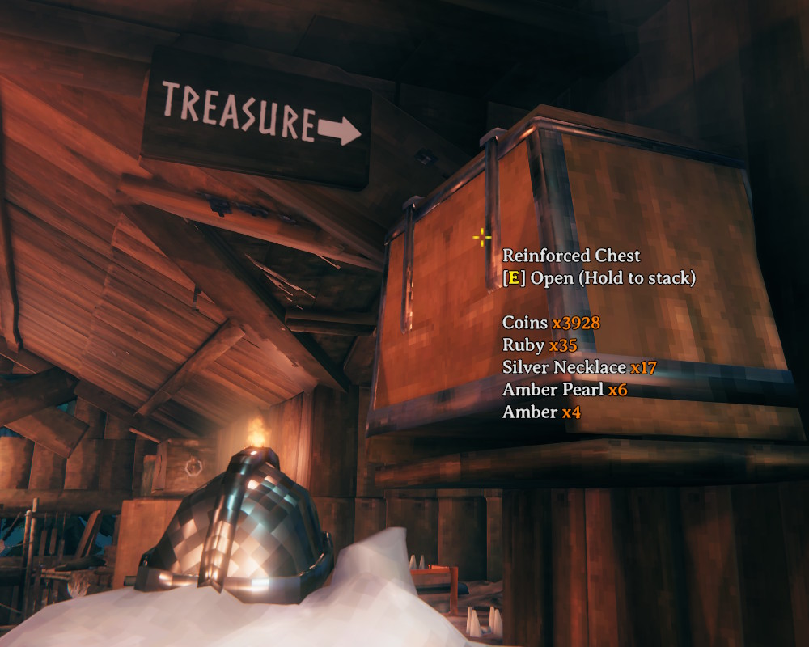
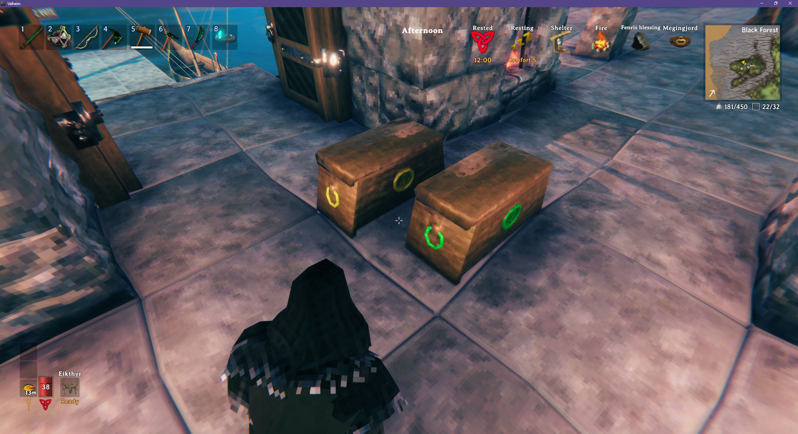

# Chest Peek

Hover over a chest to see what's inside without opening it, and spot full or empty chests at a glance.

- Lists the contents below the normal hover text, with stacks of the same item added together
- Sorted by count, largest first, showing up to 12 lines
- Respects wards - chests you don't have access to stay hidden
- Recolors a container when it's completely full - every slot holding a full stack - and optionally when it's empty
- Works on wood chests (the rope rings and the circle on the front), reinforced chests, personal chests, barrels, blackmetal chests, grausten chests and wardrobes

## Screenshots

### Showing the contents of a reinforced chest

### Full chest on the left (yellow), empty chest on the right (green)

## Configuration

`BepInEx\config\kriona.ChestPeek.cfg` is created on first run, and changes take effect as soon as the file is saved. You do not need to restart Valheim or rejoin the world.

- `EmptyColor` - color of the fittings on an empty chest, as a hex color like `#00FF00` or a name like `green`, or blank to leave them unchanged (default blank)
- `FullColor` - color of the fittings on a completely full chest, or blank to leave them unchanged (default `#FFFF00`, yellow)

## Installation

With a mod manager, install Chest Peek from [Thunderstore](https://thunderstore.io/c/valheim/p/Kriona/ChestPeek/) using r2modman or the Thunderstore Mod Manager (which install BepInExPack for Valheim), or from [Nexus Mods](https://www.nexusmods.com/valheim/mods/4341) using Vortex.

By hand:

1. Install BepInExPack for Valheim from [Thunderstore](https://thunderstore.io/c/valheim/p/denikson/BepInExPack_Valheim/) or [Nexus Mods](https://www.nexusmods.com/valheim/mods/3605)
2. Extract the zip into your Valheim folder, or copy `ChestPeek.dll` into `BepInEx\plugins`

Client-side only - other players and the server don't need it.
