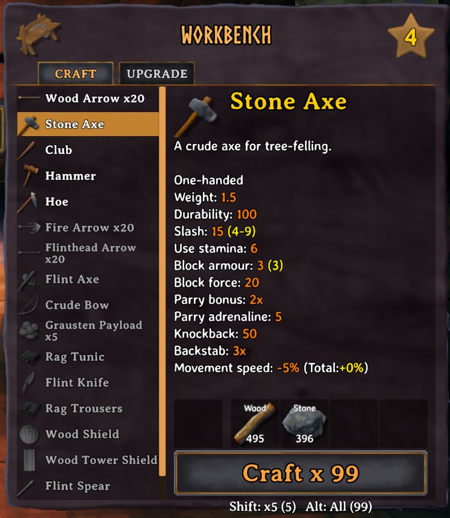
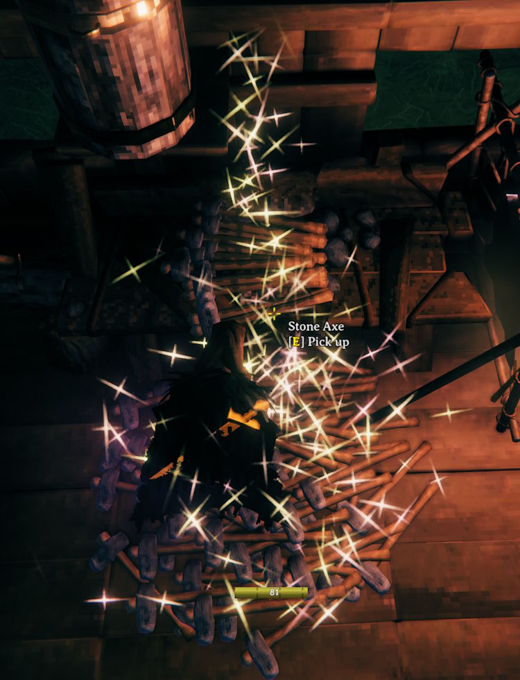

# Craft More

Hold a key while pressing Craft to craft more than one at a time, the way holding Shift crafts 5. By default Ctrl crafts a full stack and Alt crafts as many as you have the materials for, and you can add keys that craft a set number (like 10).

- `Stack` crafts as many as fit in one inventory slot
- `All` crafts as many as you have the materials for, and anything you can't carry is dropped on the ground in front of you
- Specify a number to craft that many
- The keys are listed under the Craft button with how many items each would make, along with the game's own Shift, e.g. `Shift: x5 (100)`, `Ctrl: Stack (100)` and `Alt: All (240)`
- The recipe, its requirements and the Craft button show the larger amount while the key is held
- Crafting duration scales with how many items you are crafting





## Configuration

`BepInEx\config\kriona.CraftMore.cfg` is created on first run, and changes take effect as soon as the file is saved. You do not need to restart Valheim or rejoin the world.

- `Show Hints` - lists the keys under the Craft button (default `true`)
- `Full Experience` - the game raises a crafting skill by at most one level per batch, however many crafts are in it, and the rest of the experience is lost. Turn this on to get the experience of crafting each one separately, so a large batch can raise the skill several levels. It isn't needed when `One At A Time` is `true`, since each craft then gives its own experience (default `true`)
- `One At A Time` - crafts a batch's items one after another, each going into your inventory as it's done, instead of all of them at the end. The batch takes as long either way, drops what you can't carry on the ground, and stops early if you cancel it, close the inventory or run out of materials (default `true`)

Each other line is `Key = Stack`, `Key = All` or `Key = <number>`:

```
Show Hints = true
Full Experience = true
One At A Time = true
LeftControl = Stack
LeftAlt = All
LeftShift = 10
```

- The key is a Unity KeyCode name, e.g. `LeftControl`, `LeftAlt` or `LeftShift` - either side of Ctrl, Shift, Alt and Command counts
- A number crafts that many, up to 10000
- When more than one key is held, the first line wins
- Remove a line to stop that key crafting more

## Installation

1. Install [BepInExPack for Valheim](https://www.nexusmods.com/valheim/mods/3605)
2. Extract the zip into your Valheim folder, or copy `CraftMore.dll` into `BepInEx\plugins`

Client-side only - other players and the server don't need it.
