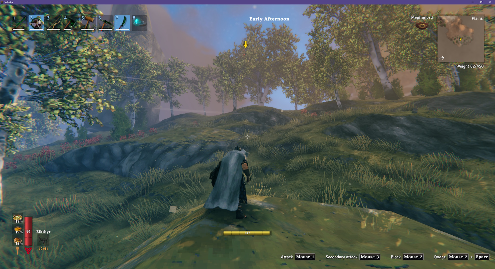
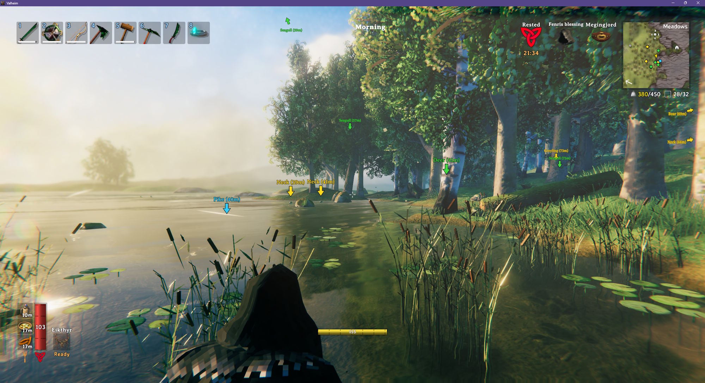
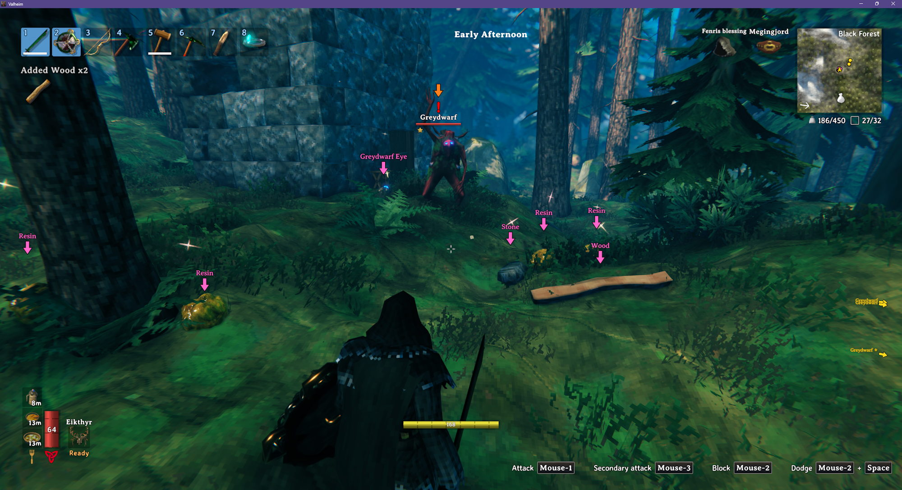
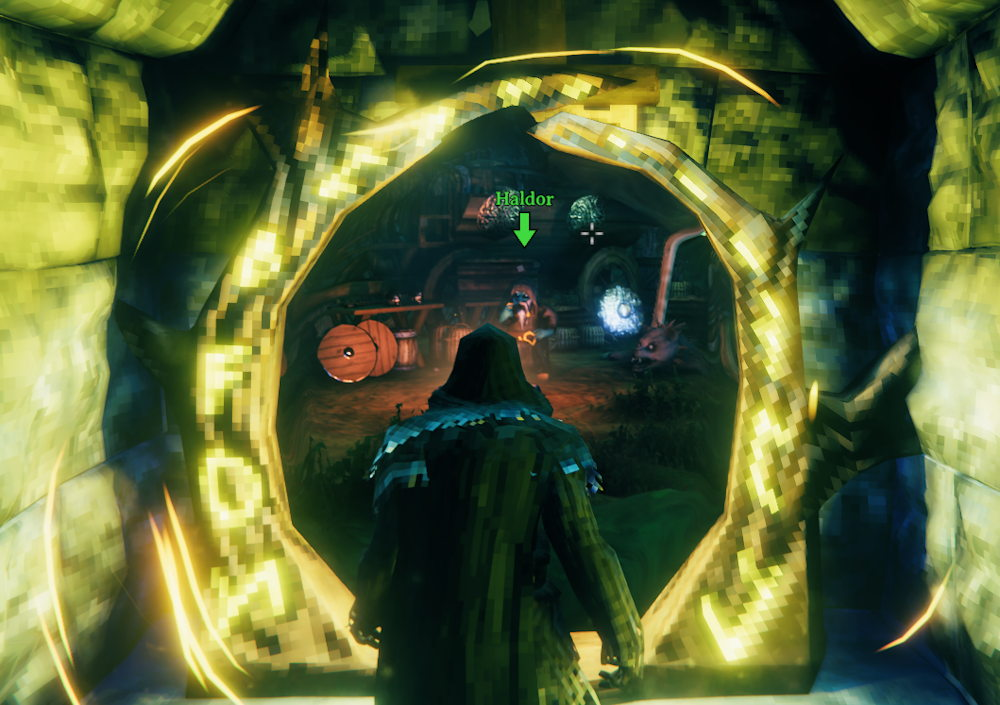

# Creature Marker

Puts a colored arrow above nearby creatures, traders, fish, birds, leviathans, other players, items on the ground and portals. Creatures that are off-screen get an arrow pinned to the edge of the screen, pointing toward them, and only creatures higher up than you get one in the top half of the screen.

- Separate colors for passive creatures, hostile creatures, creatures that are targeting you, bosses, fish, traders, leviathans and your tamed pets
- Marks traders like Haldor, Hildir and the Bog Witch, and their pets like Halstein, including through portals with [PortalPreview](#portalpreview)
- Marks leviathans and lava leviathans, so they're easy to find when you want their chitin or flametal ore
- Marks other players who are sharing their position on the map, unless they're sneaking
- Can mark every item lying on the ground, so dropped loot is easy to spot
- Can mark every portal, labeled with its tag, so you can find your way back to the one you came through
- Optional name, level and distance label on each marker, leaving out the name and level while the game shows its own above the creature
- A matching colored dot on the minimap and the large map for each marked creature
- Choose which creatures are marked - passive ones, hostile ones, or creature by creature, with separate switches for fish, birds and leviathans and a lowest level for creatures and fish
- Includes creatures added by other mods

## Screenshots

### An arrow appearing above a Deathsquito

### Showing names, distances, fish, and birds

### Items on the ground

### Portal Preview

Support for Portal Preview ([Nexus](https://www.nexusmods.com/valheim/mods/3977), [Thunderstore](https://thunderstore.io/c/valheim/p/Ivvty/PortalPreview/)) by Ivvty

## Configuration

`BepInEx\config\kriona.CreatureMarker.cfg` is created when you first load a world with the mod, and changes take effect as soon as the file is saved. You do not need to restart Valheim or rejoin the world.

| Setting | Default | Description |
| --- | --- | --- |
| Show On Screen | true | Shows an arrow above each marked creature, pinned to the screen edge when it is off-screen |
| Show On Map | true | Shows a dot on the minimap and the large map for each marked creature, except while you are in a dungeon |
| Max Distance | 50 | How far away, in meters, a creature can be and still get a marker (5 - 500) |
| Far Distance | 50 | How far away, in meters, a creature has to be for its marker to be drawn at Far Scale (5 - 500) |
| Far Scale | 0.66 | Size of the arrow and label of a creature beyond Far Distance (0.2 - 1). 1 keeps every marker full size |
| Bob Height | 0 | How far, in pixels, an on-screen arrow bobs up and down (0 - 30). 0 disables bobbing |
| Show Name | false | Shows the creature's name with its marker |
| Show Distance | false | Shows the creature's distance with its marker |
| Show Level | false | Shows a ⭐ for each of a creature's stars, and a fish's level like Perch[3], after the name. Creatures without stars and level 1 fish show nothing |
| Passive Color | #40D940 | Marker color for creatures that won't attack you, including birds |
| Hostile Color | #FFD91A | Marker color for creatures that will |
| Angry Color | #FF801A | Marker color for hostile creatures that are targeting you - see [Multiplayer](#multiplayer) |
| Boss Color | #FF3333 | Marker color for bosses |
| Fish Color | #33CCFF | Marker color for fish |
| Pet Color | #FFF | Marker color for creatures you have tamed |
| Trader Color | | Marker color for traders like Haldor, Hildir and the Bog Witch. Leave it blank to use Passive Color. Their pets, like Halstein, always use Passive Color |
| Leviathan Color | #B366FF | Marker color for leviathans and lava leviathans |
| Player Color | #FFF | Marker color for other players |
| Item Color | #FF66CC | Marker color for items lying on the ground |
| Portal Color | #B08EFF | Marker color for portals |
| All Passive Creatures | false | Marks every creature that won't attack you, including traders and their pets |
| All Hostile Creatures | true | Marks every creature that will attack you |
| All Fish | false | Marks every fish |
| All Birds | false | Marks every bird |
| All Leviathans | true | Marks every leviathan and lava leviathan. A leviathan's marker goes away once it starts diving after being hit |
| All Players | true | Marks every other player who is sharing their position on the map, except while they're sneaking |
| Items On Ground | false | Marks every item lying on the ground. A stack's name shows how many items are in it, like "Wood x5". Food placed on a table and fish, which follow All Fish, aren't included |
| All Portals | false | Marks every portal. Its name is the portal's tag, or the kind of portal when it has no tag |
| Min Creature Level | 0 | Lowest level a creature needs to get a marker, which is its number of stars (0 - 9). 0 marks every creature, and 1 marks only creatures with stars. Traders, their pets and leviathans aren't affected |
| Min Fish Level | 1 | Lowest level a fish needs to get a marker (1 - 5). 1 marks fish of every level |

Every creature, trader, fish, bird and leviathan also gets its own line, `Prefab = inherit/true/false ## Name`. `inherit` follows the All switches, while `true` or `false` always shows or hides that one's marker. A trader's pet, like Halstein, gets its line the first time you come near it.

Colors can be `#RRGGBB` or a color name like `red`, `yellow`, `green`, `cyan` or `magenta`.

## Multiplayer

In multiplayer, each creature's AI runs in one player's game, usually the player who was nearby first, and only that game knows who the creature is targeting. Creature Marker shares that target with the other players, so Angry Color only goes to creatures that are targeting you, not ones chasing another player, a tamed creature or a deer.

When the player whose game runs a creature doesn't have the mod, nothing shares its target, and its marker uses Angry Color whenever it is alerted and after anyone - you, another player or another creature. If a player with the mod ran the creature earlier, the target they shared is kept until the creature calms down, so for a while it can still be the creature's old target.

## PortalPreview

With PortalPreview installed, traders and their pets get markers where you see them through a portal's preview of where it leads. PortalPreview saves a still picture of each portal's surroundings, and Creature Marker remembers the traders and pets that were there when it did, in `BepInEx\cache\kriona.CreatureMarker`. Other creatures aren't marked through portals, since they would have moved on by the time you look.

These markers follow the same switches and colors as traders and pets on this side of the portal, only show within the portal's opening, never over its frame, and don't get a dot on the map.

## Installation

With a mod manager, install Creature Marker from [Thunderstore](https://thunderstore.io/c/valheim/p/Kriona/CreatureMarker/) using r2modman or the Thunderstore Mod Manager (which install BepInExPack for Valheim), or from [Nexus Mods](https://www.nexusmods.com/valheim/mods/4342) using Vortex.

By hand:

1. Install BepInExPack for Valheim from [Thunderstore](https://thunderstore.io/c/valheim/p/denikson/BepInExPack_Valheim/) or [Nexus Mods](https://www.nexusmods.com/valheim/mods/3605)
2. Extract the zip into your Valheim folder, or copy `CreatureMarker.dll` into `BepInEx\plugins`

Client-side only - other players and the server don't need it, though Angry Color is only exact for creatures run by players who have it (see [Multiplayer](#multiplayer)).
