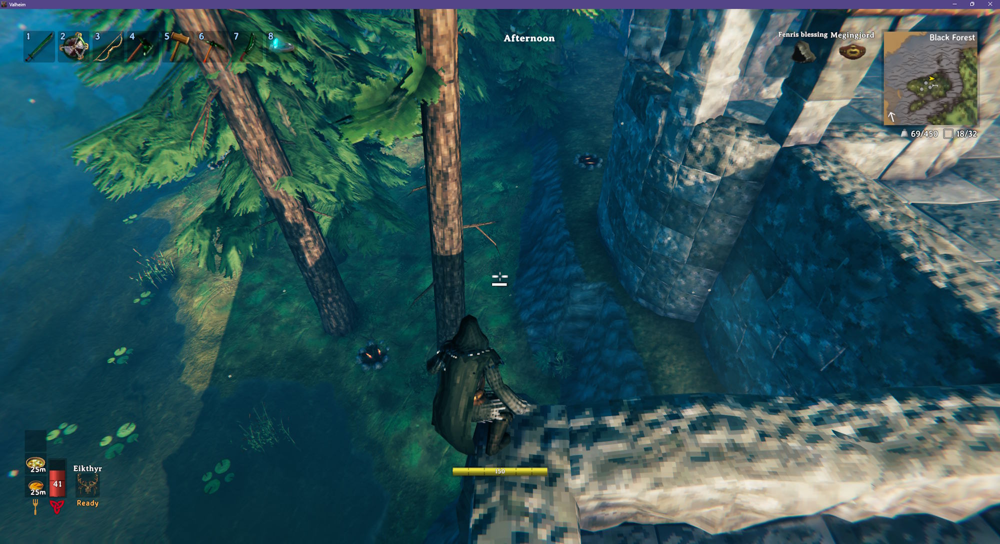

# Safe Sneak

Stops you from walking off ledges while you're sneaking, so you can creep right up to the edge of a cliff, roof or high scaffold without falling. It works just like sneaking in Minecraft.

- You stop just short of the edge, close enough to look over it
- Walking at an angle into an edge slides you along it, so you can sneak along a narrow beam or around the rim of a platform
- Getting hit or knocked back can still push you off - only your own walking is held back
- Jumping, dodging or standing up lets you move off the edge as usual
- Slopes you can walk or slide down don't count as a ledge, only drops steeper than that

A picture of me not falling... not very exciting. Sorry.

## Configuration

`BepInEx\config\kriona.SafeSneak.cfg` is created on first run, and changes take effect as soon as the file is saved. You do not need to restart Valheim or rejoin the world.

- `MaxDrop` - how far the ground can drop away in front of you, in meters, before sneaking stops you at the edge - lower stops you at smaller steps, higher lets you sneak down them (default `1`)

## Installation

With a mod manager, install Safe Sneak from [Thunderstore](https://thunderstore.io/c/valheim/p/Kriona/SafeSneak/) using r2modman or the Thunderstore Mod Manager (which install BepInExPack for Valheim).

By hand:

1. Install BepInExPack for Valheim from [Thunderstore](https://thunderstore.io/c/valheim/p/denikson/BepInExPack_Valheim/) or [Nexus Mods](https://www.nexusmods.com/valheim/mods/3605)
2. Extract the zip into your Valheim folder, or copy `SafeSneak.dll` into `BepInEx\plugins`

Client-side only - other players and the server don't need it.
