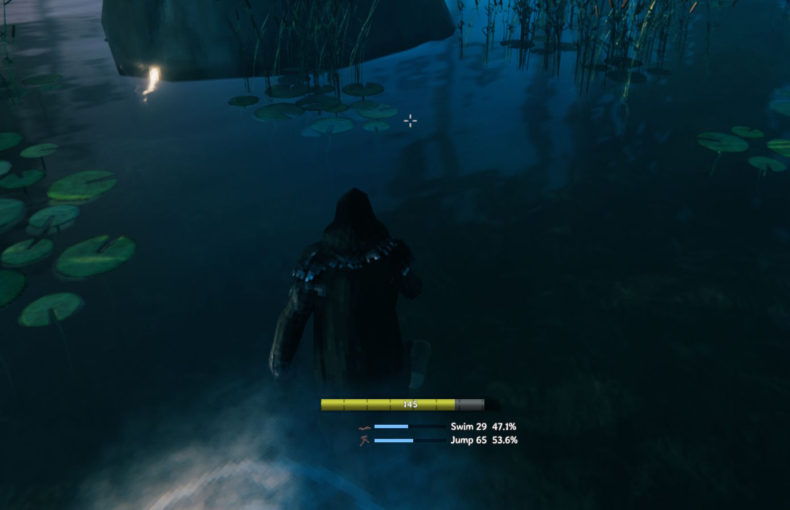

# Skill Progress

Shows a progress bar under the stamina bar while you train a skill (e.g., swimming) so you can see how close you are to the next level.

## Installation

With a mod manager, install Skill Progress from [Thunderstore](https://thunderstore.io/c/valheim/p/Kriona/SkillProgress/) using r2modman or the Thunderstore Mod Manager (which install BepInExPack for Valheim), or from [Nexus Mods](https://www.nexusmods.com/valheim/mods/4935) using Vortex.

By hand:

1. Install BepInExPack for Valheim from [Thunderstore](https://thunderstore.io/c/valheim/p/denikson/BepInExPack_Valheim/) or [Nexus Mods](https://www.nexusmods.com/valheim/mods/3605)
2. Extract the zip into your Valheim folder, or copy `SkillProgress.dll` into `BepInEx\plugins`

Client-side only - other players and the server don't need it.
