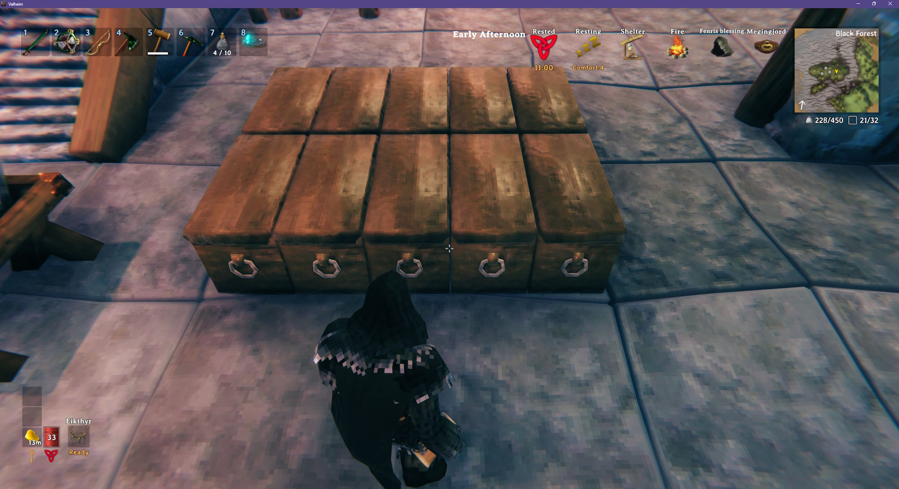
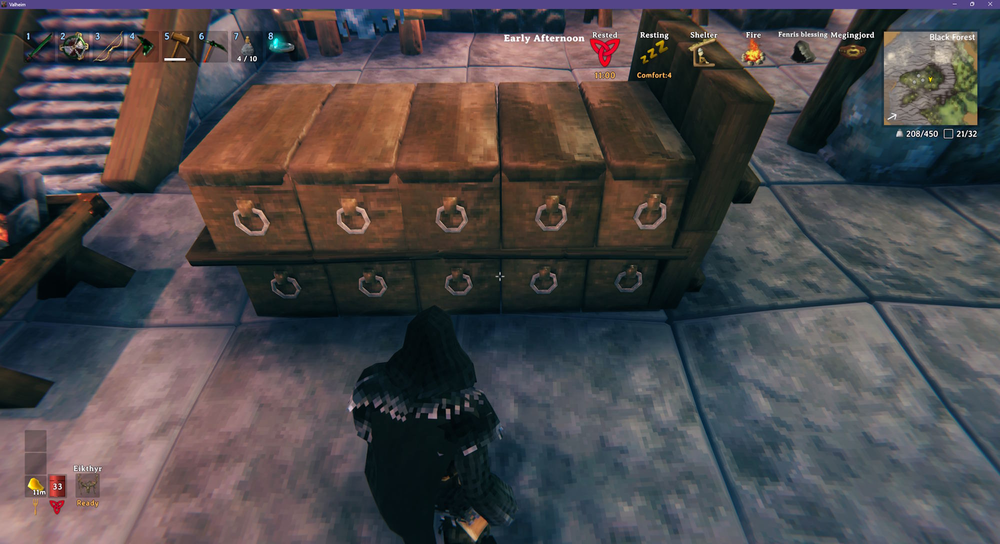
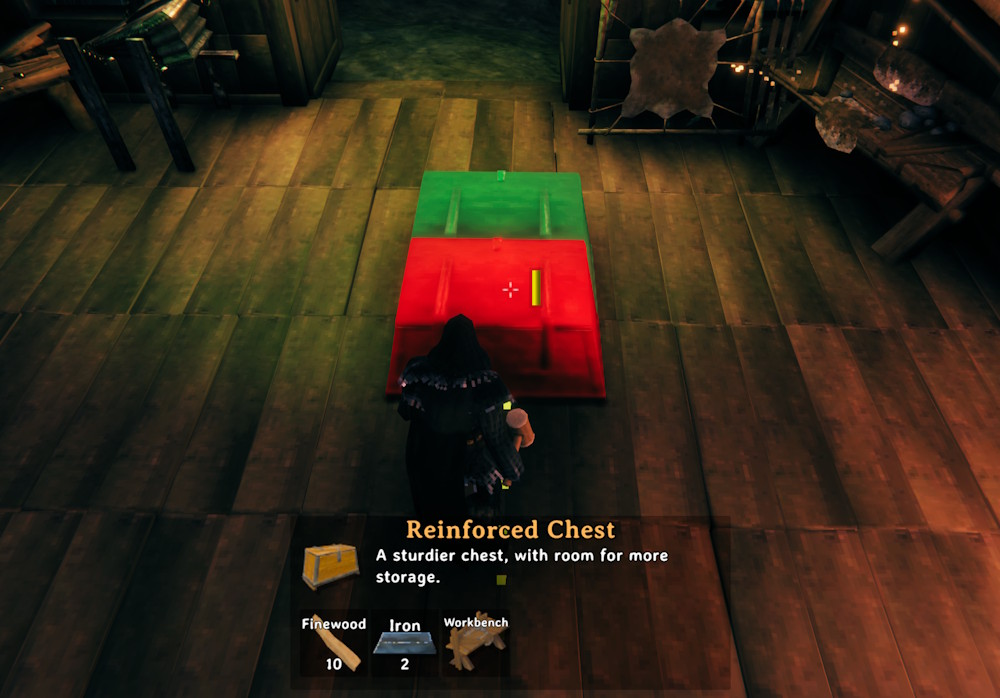
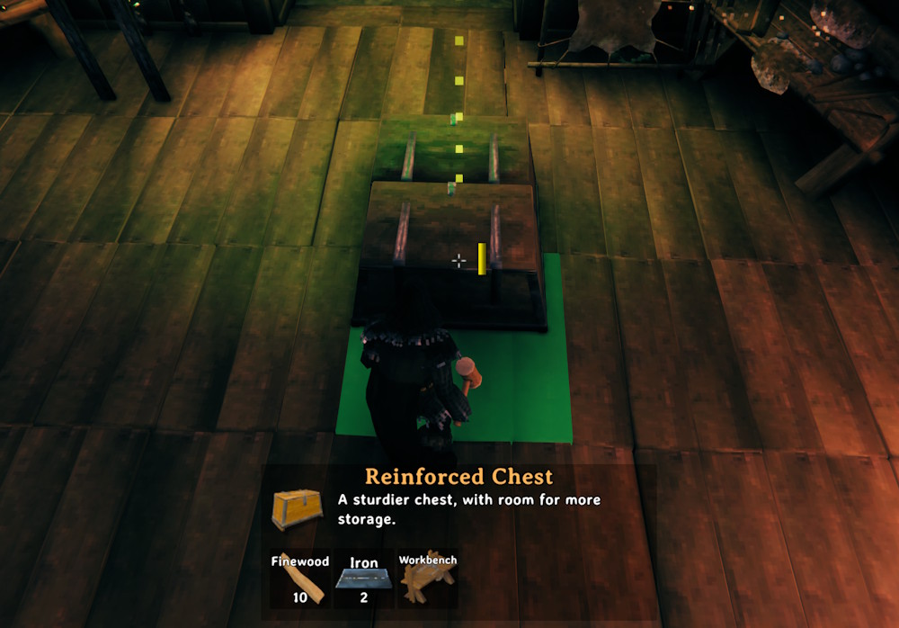

# Snap Points

Gives chests, resource stacks, tables, benches, banners, armor stands and item stands snap points, so they line up with each other the way walls and floors do. Any other build piece can be given snap points (or have its snap points taken away) via config.

- A snap point is added at each corner of the build piece - chests can be placed side by side in neat rows
- The top corners let you stack build pieces that can be built on, like tables and metal bar stacks, or lay a floor over a row of chests. Chests and piles can't be built on each other, so they don't offer to snap on top of one another
- Works with wood stacks, stone and coal piles, metal bar stacks and the other resource stacks, so storage walls line up
- Tables snap end to end for long banquet tables, with benches lined up beside them
- Banners snap by their wooden hanger as well as their cloth, so the cloths can hang edge to edge
- Armor stands snap 1m apart with room for the armor, as well as close together by their bodies
- Item stands line up in rows and grids on walls and floors, and snap to the corners of walls and floors
- Cycle through the corners by hand with the game's snap point key (E) to pick which corner snaps
	- You can disable snap points (hold Left Shift) to let you free-place a piece.





## Snapping Tricks

When placing two chests, you **cannot** snap a chest by attempting to snap to the side of the chest. This is because chests don't support other build pieces, so you can't try to support it on the side of the chest. You **must** look at the floor, which will snap to the side of the chest but will attempt to use the floor as support (and succeed).

❌No:



✅Yes:



## Configuration

`BepInEx\config\kriona.SnapPoints.cfg` is created the first time you load a world, and changes take effect as soon as the file is saved. You do not need to restart Valheim or rejoin the world.

The file has one line per build piece, grouped by the tool that builds it, with the piece's name in game after `##`:

```
piece_chest_wood = true ## Chest
rug_wolf = inherit ## Wolf rug
piece_chest_private = false ## Personal chest
```

- `true` - adds a snap point at each corner of the piece, keeping any snap points it has from the game
- `false` - takes away all of the piece's snap points
- `inherit` - leaves the piece's snap points as the game's default

Every chest, the resource stacks and piles, the tables, the benches, the banners, the armor stands and the item stands start as `true`, and everything else starts as `inherit`.

Build pieces added by other mods are added to the file when Valheim loads.

## Installation

1. Install [BepInExPack for Valheim](https://www.nexusmods.com/valheim/mods/3605)
2. Extract the zip into your Valheim folder, or copy `SnapPoints.dll` into `BepInEx\plugins`

Client-side only - other players and the server don't need it.
