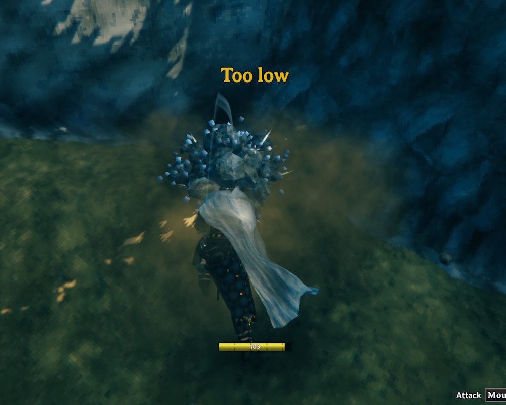

# Too Low

Shows a brief "Too low" message when your pickaxe hits ground that is already at the game's 8m digging limit so you know to stop swinging.

- The message fades out quickly and clears as soon as you swing again
- Stays silent when the dig is blocked by a ward or a no-build area

## Installation

With a mod manager, install Too Low from [Thunderstore](https://thunderstore.io/c/valheim/p/Kriona/TooLow/) using r2modman or the Thunderstore Mod Manager (which install BepInExPack for Valheim), or from [Nexus Mods](https://www.nexusmods.com/valheim/mods/4345) using Vortex.

By hand:

1. Install BepInExPack for Valheim from [Thunderstore](https://thunderstore.io/c/valheim/p/denikson/BepInExPack_Valheim/) or [Nexus Mods](https://www.nexusmods.com/valheim/mods/3605)
2. Extract the zip into your Valheim folder, or copy `TooLow.dll` into `BepInEx\plugins`

Client-side only - other players and the server don't need it.
