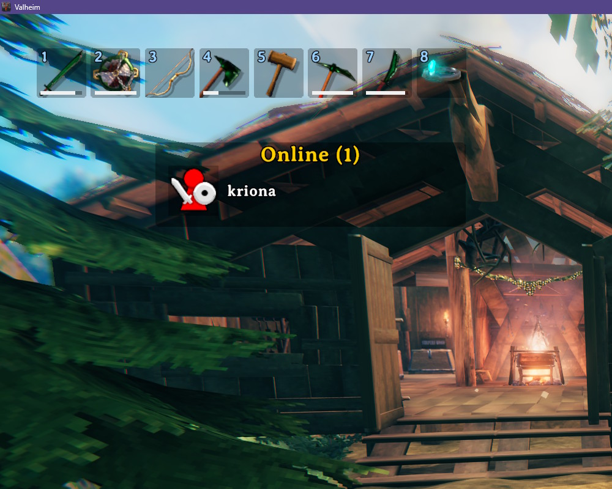
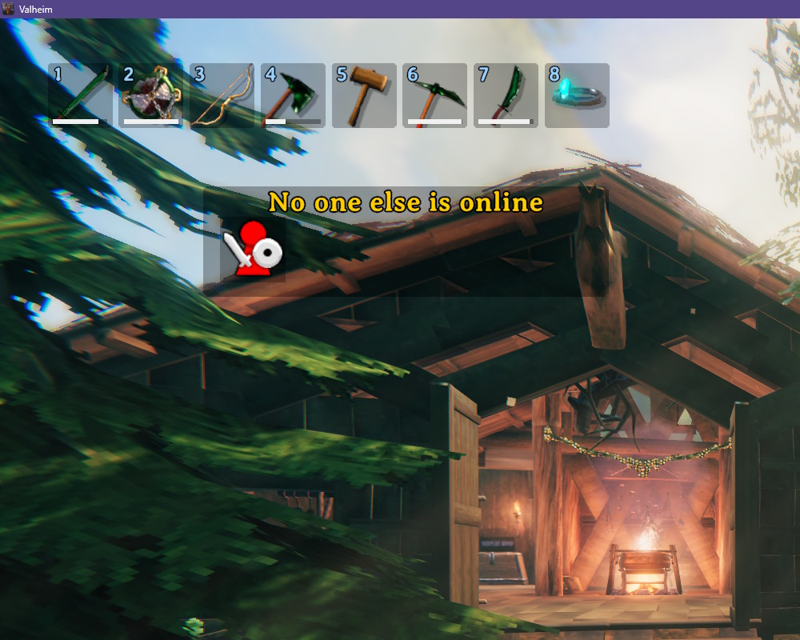

# Who's Online

Lists the other players on the server when you join in a popup and in chat.

- Shown once per connection, the first time you spawn - not on respawns after death
- Only runs on servers hosted by someone else

## Screenshots

### When another player is online

### When no one else is online

## Installation

With a mod manager, install Who's Online from [Thunderstore](https://thunderstore.io/c/valheim/p/Kriona/WhosOnline/) using r2modman or the Thunderstore Mod Manager (which install BepInExPack for Valheim), or from [Nexus Mods](https://www.nexusmods.com/valheim/mods/4347) using Vortex.

By hand:

1. Install BepInExPack for Valheim from [Thunderstore](https://thunderstore.io/c/valheim/p/denikson/BepInExPack_Valheim/) or [Nexus Mods](https://www.nexusmods.com/valheim/mods/3605)
2. Extract the zip into your Valheim folder, or copy `WhosOnline.dll` into `BepInEx\plugins`

Client-side only - other players and the server don't need it.
