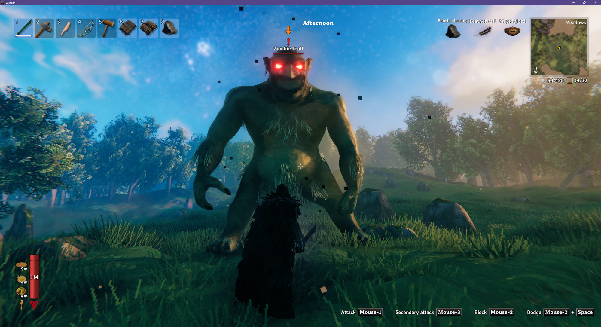
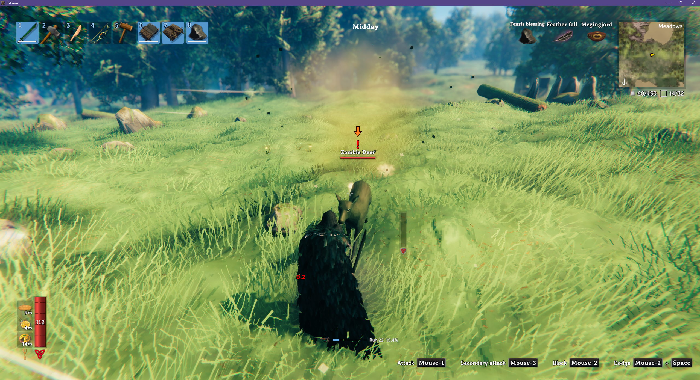
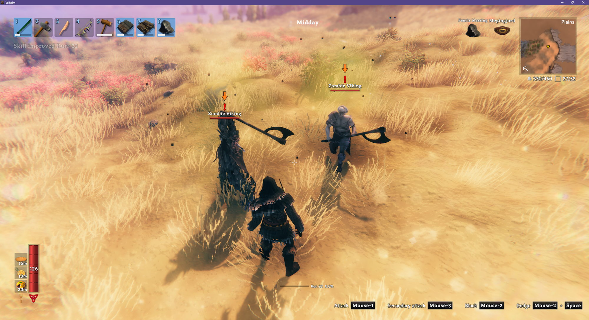

# Zombie Apocalypse

Slain creatures don't stay dead - a few seconds after a creature dies, its corpse raises from the dead as a zombie that keeps fighting.

**This mod makes Valheim significantly harder.**

You will now need to fight many mobs twice, and zombie Vikings are a challenging enemy.

- A zombie rises with 25-75% of its health, so it looks battered as it gets up
- A zombie first aggros whoever killed it
- A creature's corpse keeps what it held, and its zombie gets up holding the same thing - a troll that dies with a log keeps it, and a fuling keeps its weapon and shield
- Zombies take damage like the undead - they're immune to poison, weak to spirit damage (e.g., silver weapons) and fire, and tougher against arrows and spears
- Zombies are undead and always hostile, and like all undead, they leave other undead alone
- Animals that normally run away (e.g., deer, hares, seals and young animals) will, as zombies, hunt you down instead
- Zombies slow down as they're hurt - at full speed down to half health, then slowing steadily to two-thirds speed as their health runs out
- A creature's loot drops only drops when its zombie dies, after killing it a second time
- From the Black Forest on, a zombie's corpse has a 25% chance to leave a small cloud of weak poison for a few seconds when it poofs

Even the fauna will fight you.

## Display

- A zombie's skin is tinted, washed out and blotched with dark rotten patches
- Creatures with glowing eyes (e.g., greydwarfs, dvergr, necks, lox and fenrings) have them turned red, and ones with eyes painted on but eye bones (e.g., boars, deer, wolves and trolls) get glowing red eyes
- Zombies carry the draugr's swarm of flies and a faint green haze
- Zombies on two legs (e.g., greydwarfs, fulings, trolls and Vikings) lurch as they walk - hunched over with their head lolling to one side, leaning onto a stiff leg they drag and letting the arm on that side hang. Zombies on four legs (e.g., wolves, boars and deer) limp on a stiff front leg with their head hung low. Both lurch harder as they're hurt

## Your Death

When a zombie kills you, your own body gets back up as a tombstone zombie Viking with your name, looks and health, wearing your armor and carrying everything you had (except food, silver ore and ingots, and spirit weapons / ammo). If you still have corpse run from picking up your tombstone, your body stays dead.

- It guards your tombstone (or where you fell, if there isn't one)
- It won't chase anything more than 20 meters from the tombstone, and if it ends up much farther out than that, it gives up the fight and returns to the spot you died
- Its bows and crossbows shoot your arrows and bolts, so there are fewer left when you get them back
- When it's killed, it drops everything it carried in a tombstone
- It has a chance to use the forsaken power you most recently had available
- It fights with your own skill in each weapon, and blocks with your shield as well as your Blocking skill allows

## Zombie Vikings

Zombie Vikings roam the world, each with gear appropriate to the biome it spawns in.

- By day they spawn in the Dark Meadows, Ruin Black Forest, the Swamp, and the Ashlands, up to 1 star
- At night they spawn in every biome, up to 2 stars. Night zombie Vikings run faster than normal Vikings
  - Rarely and one at a time in the Meadows
  - Up to 2 in the Black Forest
  - In groups of 1-3 from the Swamp on
- Night zombie Vikings flee at dawn like other night creatures
- An Ashlands zombie Viking takes no damage from the lava or the boiling sea, though fire from anything else still burns it
- Draugr body piles spawn zombie Vikings, too
- An abandoned house with no creatures of its own has a 66% chance to hold 1-2 Vikings - with Viking Villages, unless it's within 100 meters of an abandoned farm, whose living Vikings have taken it in
- A Viking has a 65% chance of wearing armor (always the chest and legs, with a 50% chance each of the set's helmet and cape), an 85% chance of wielding a weapon and a 40% chance of wearing a shield, unless its weapon takes both hands. From the Mountains on, every Viking wears a cape - the set's, or else the biome's own (a wolf fur cape in the Mountains, a lox cape in the Plains, a feather cape in the Mistlands, an Asksvin cloak in the Ashlands and a moose hide cape in the Deep North). Every star upgrades its gear one level, and everything is worn (50-95% durability)
- A Viking with a bow or crossbow carries 100 arrows or bolts appropriate to its biome. It never carries weapons or ammo that deal spirit damage, and a Deep North Viking never carries Dyrnwyn
- Its health, skills, fists and coins depend on its biome - from 50 health, skills of 0-12 and 0-10 coins in the Meadows to 1200 health, skills of 88-100 and 200-300 coins in the Deep North, each skill rolled on its own within the range, every one at least 1 - and stars multiply its health and coins
- Its armor protects it half as well as a player's and wears down the same way, its weapons and shield wear down as it uses them, and it raises its shield against attacks, more often and with better timing the more skilled it is. It knows the reach of what it fights with, closing in until its swing will land before it strikes - right up close with a knife or its fists, farther off with a polearm. It swings every 2 seconds, as monsters do
- When it dies it drops its coins, and 0-2 entrails from the Swamp on, multiplied by its stars, and each piece of its gear has a 5% chance to drop, at most 2
- Spawn one with the console command `spawn ZombieViking`

## Raids

Zombie Vikings can raid your base:

- The raid can come to a base in any biome from the start of the game, without beating a boss first, alongside the game's own raids
- Its Vikings are armed for the biome the base is in, so a Meadows base gets Meadows Vikings and a Plains base gets Plains Vikings
- Fewer Vikings come at once than in other raids, since Vikings are a little tougher than other raiders
- Any zombie that rises during a raid hunts players like the raiders until the raid ends, then stays as an ordinary zombie. A tombstone zombie Viking keeps guarding your tombstone instead

## Forsaken Power

Zombie Viking have a chance to use a forsaken power appropriate for their biome the first time it spots an enemy. A tombstone zombie Viking a 50% chance to use your last selected power when a player first comes near. Once a zombie Viking uses its forsaken power, there is a global 30 second cooldown.

## Dvergr Mages

Every living dvergr mage can cast a powerful white bolt of spirit damage that deals a lot of damage to undead, and a white nova of spirit damage that bursts out around them when the undead get close. When fighting the undead, these are their preferred spells.

Note that zombies don't cast healing spells, so a zombie greydwarf shaman or dvergr healer can't heal its allies.

## Silver-Lined Weapons

Line your weapons with silver so the creatures you kill with them stay dead.

- At a forge of level 3, the Upgrade tab has a "Silver-line" entry for each weapon you carry that can be lined - any weapon with metal in its recipe that doesn't already deal spirit damage
- Lining costs silver - a quarter of the metal in the weapon's recipe, at least 1 - and 1 ectoplasm
- A silver-lined weapon deals extra spirit damage - 5% of its damage at level 1, at least 5. Only the undead and zombies take spirit damage, so it doesn't change how hard it hits anything living, but a creature it kills doesn't rise
- The lining stays on the weapon through upgrades and repairs, in chests, when traded, and in other worlds. In a world without the mod, it does nothing
- Like other spirit weapons, a silver-lined weapon stays in your tombstone rather than going with your tombstone zombie Viking
- The first time you have smelted silver, Hugin tells you about silver-lining

## Immune to Zombification

Creatures that do not turn into zombies:

- Undead (draugr, skeletons, ghosts, wraiths, swamp blobs and oozers, leeches, etc.)
- The charred, Bonemaw serpents, and fallen valkyries
- The Deep North's skeletons and shadows
- Bosses
- Creatures killed by spirit damage (e.g., silver or silver-lined weapons, or dvergr mages' spells)
- Creatures that took at least 25% of their damage as fire (e.g., burning, fire arrows or a fire staff), counted after their resistances. Healing takes damage off each kind in proportion, and a creature that heals back to full health starts over
- Summons, stone golems or creatures that leave no corpse to get up from, like seekers, ticks, serpents, surtlings and deathsquitos

## With Viking Villages

With [Viking Villages](https://thunderstore.io/c/valheim/p/Kriona/VikingVillages/) installed too, the living Vikings of its villages live through the apocalypse:

- A living Viking who dies rises as a zombie Viking with their looks, gear and skills, by the same rules as any slain creature - `RiseChance`, `FireStaysDead` and spirit damage - and drops coins like any zombie Viking when killed in turn, along with the wood and loot they carried for their village
- They stand ready over corpses about to rise and keep clear of poison clouds
- What they talk about follows the world's zombies - the dead walking while `RiseChance` is above 0, burning the dead while `FireStaysDead` is above 0 (and silver always), dead deer while `AnimalsRise` is on, the dead raiding while `VikingRaids` is on, and newcomers rising while `TombstoneZombies` is on
- The empty abandoned houses within 100 meters of a farm are its living Vikings', so zombie Vikings never hold them

Any version of Zombie Apocalypse works with any version of Viking Villages - what one has that the other doesn't know about yet is left out.

## Configuration

`BepInEx\config\kriona.ZombieApocalypse.cfg` is created on first run, and changes take effect as soon as the file is saved. You do not need to restart Valheim or rejoin the world.

In multiplayer, every player uses the server's settings while connected to it, and gets its changes as soon as they're saved - except `ZombieBuzzVolume` and `ZombieHazeStrength`, which each player sets for themselves. A player's own settings come back when they leave the server.

Rising:

- `RiseChance` - percent chance that a slain creature rises - with Viking Villages, the living Vikings talk of the dead rising and stand ready over their village's dead while it's above 0 (default `100`)
- `FireStaysDead` - a creature that took at least this percent of its damage as fire stays dead, or `0` to let burned creatures rise too, which also keeps Viking Villages' living Vikings from talking of burning the dead (default `25`)
- `RiseDelay` - seconds a corpse lies on the ground before it starts to get up (default `5`)
- `RiseDuration` - seconds a corpse takes to get up (default `2.5`)
- `WakeUpAnimation` - creatures that can sleep get up with their own wake-up animation (default `true`)
- `TamedCreaturesRise` - tamed creatures rise too, as wild zombies, and `false` leaves them dead (default `true`)
- `AnimalsRise` - animals that normally run away rise too, as zombies that ram their enemies, and `false` leaves them dead (default `true`)
- `ExcludedCreatures` - creatures that never rise, as a comma-separated list of prefab names, where a name ending in `*` matches every prefab starting with it. The default lists the undead creatures outside the Undead faction and creatures that were never alive: `Charred_*, Skeleton_DeepNorth, BonemawSerpent, FallenValkyrie, ShadowPerson, StoneGolem, Mistile`

Zombies:

- `ZombieHealth` - a zombie's health as a percent of the creature's (default `100`)
- `WoundedSpeed` - how fast a zombie moves as its health runs out, as a percent of its full speed - it moves at full speed down to half health, then slows steadily to this (default `66`)
- `ZombieLurch` - how much zombies lurch as they walk, from `0`, which leaves them walking as the creature does, to `100`. Each zombie lurches somewhere between this and twice this (default `100`)
- `PoisonCloudChance` - percent chance that a zombie's corpse leaves a small cloud of weak poison when it rots away, from the Black Forest on (default `25`)
- `UndeadWeaknesses` - zombies take damage like the undead (default `true`)
- `AnimalDamage` - blunt damage a zombie animal's ram does, plus half as much again for each star, and two and a half times as much for a Deep North seal (default `10`)
- `ZombieName` - word put in front of a zombie's name, or empty to leave it as it is (default `Zombie`)
- `ZombieColor` - color a zombie's skin is multiplied by, as `RRGGBBAA` hex, where white leaves it as it is (default `B2D999FF`)
- `ZombieSaturation` - how much a zombie's colors are washed out, from `0` for not at all to `-1` for gray (default `-1`)
- `ZombieMottling` - how dark the rotten patches on a zombie's skin are, from `0` for none to `1` for black (default `0.25`)
- `ZombieMottleSize` - how many rotten patches fit across a creature's texture, where higher makes smaller patches (default `6`)
- `ZombieEyes` - zombies' eyes glow `ZombieEyeColor` (default `true`)
- `ZombieEyeColor` - color zombies' eyes glow, as `RRGGBBAA` hex (default `FF1A0DFF`)
- `ZombieFlies` - zombies carry the draugr's flies and green haze (default `true`)
- `ZombieBuzzVolume` - how loud zombies' flies buzz, from `0` for silent to `1`, where a beehive is `0.8` (default `0.4`)
- `ZombieHazeStrength` - how much green haze a zombie gives off, as a percent of a draugr's. Zombies crowded together thin theirs further, so a crowd's haze adds up to about three zombies' worth (default `50`)

Death:

- `TombstoneZombies` - when a zombie kills you, your body gets back up as a tombstone zombie Viking carrying your things (default `true`)

Raids:

- `VikingRaids` - zombie Vikings can raid your base, and `false` leaves them out of the raids, though a raid already underway carries on (default `true`)

Viking Gear:

- `ZombieArmorChance` - percent chance that a zombie Viking wears armor, always the set's chest and legs (default `65`)
- `HelmetChance` - percent chance that a zombie Viking wearing armor also wears the set's helmet (default `50`)
- `CapeChance` - percent chance that a zombie Viking wearing armor also wears the set's cape - from the Mountains on, every one wears one (default `50`)
- `ZombieWeaponChance` - percent chance that a zombie Viking wields a weapon, and fights with its fists otherwise (default `85`)
- `ShieldChance` - percent chance that a zombie Viking carries a shield, unless its weapon takes both hands (default `40`)
- `ZombieStarsUpgradeGear` - each of a zombie Viking's stars upgrades its gear one level, and `false` leaves it all at level 1 (default `true`)
- `ZombieDurabilityMin` - least durability a zombie Viking's gear spawns with, as a percent of full (default `50`)
- `ZombieDurabilityMax` - most durability a zombie Viking's gear spawns with, as a percent of full (default `95`)
- `GearDropChance` - percent chance that a zombie Viking drops each piece of its gear, as worn as it is, when it dies (default `5`)
- `GearDropMax` - most pieces of gear a zombie Viking drops (default `2`)
- `ZombieArmorEffectiveness` - how well armor protects a zombie Viking, tombstone ones included, as a percent of how well it protects a player (default `50`)

Forsaken Powers:

- `WorldPowerChance` - percent chance that a zombie Viking of the world uses its biome's forsaken power the first time it spots an enemy (default `10`)
- `TombstonePowerChance` - percent chance that a tombstone zombie Viking uses your forsaken power when a player first comes near, if the power was ready when you died (default `50`)
- `PowerCooldown` - seconds after any zombie Viking uses a forsaken power before another can, and a Viking whose chance comes up during it loses its chance (default `30`)

## Installation

With a mod manager, install Zombie Apocalypse from [Thunderstore](https://thunderstore.io/c/valheim/p/Kriona/ZombieApocalypse/) using r2modman or the Thunderstore Mod Manager (which install BepInExPack for Valheim).

By hand:

1. Install BepInExPack for Valheim from [Thunderstore](https://thunderstore.io/c/valheim/p/denikson/BepInExPack_Valheim/) or [Nexus Mods](https://www.nexusmods.com/valheim/mods/3605)
2. Extract the zip into your Valheim folder, or copy `ZombieApocalypse.dll` into `BepInEx\plugins`

## Multiplayer

In multiplayer, the server and every player need the same version of the mod. A server with it turns away a player without it, or with another version, and says why. On a server without it, the mod stays off, nothing rises and the player can still join - and its zombie Vikings, poison clouds and spirit spells can't be spawned there, nor its raid started, since no one else would have them.
